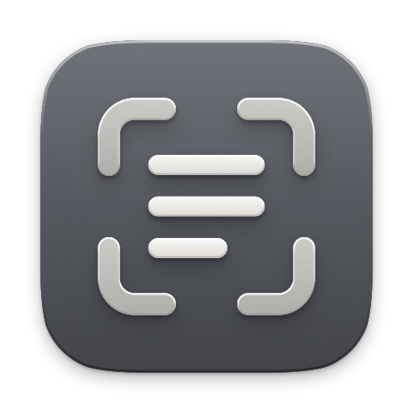

# TextHunter

TextHunter lives in the Mac menu bar and copies the text from any part of the screen. Press the shortcut, drag over the text you want, and the text is on the clipboard. There is no window, no preview and no screenshot left behind.

## How it works

1. Choose **Start Capture** from the menu bar icon, or press the shortcut (⇧⌘2 by default).
2. Drag over an area of the screen. This is the standard macOS selection, the same as ⇧⌘4. Press Esc to cancel.
3. TextHunter reads the text with Apple's on-device text recognition (the Vision framework, the technology behind Live Text) and puts it on the clipboard.

The menu bar icon turns into a check mark for a moment when the text has been copied. If the area has no text, the icon gives a short wiggle and the clipboard is left as it was.

Recognition runs entirely on your Mac. The captured image is saved to a temporary file, read, and deleted at once. Nothing is sent anywhere.

## Joining wrapped lines

Text copied from a book or an article usually breaks at the end of every line. With **Join wrapped lines** turned on (the default), TextHunter puts paragraphs back together:

- A line break is removed when the line ended only because it ran out of room, that is when the first word of the next line would not have fitted.
- Words split with a hyphen at the end of a line are mended ("infor-" + "mation" → "information").
- Real breaks are kept: the end of a paragraph, extra space between paragraphs, a first-line indent after a full stop, list items, headings and other short lines.
- Narrow blocks such as lists of single words are left as they are.

This is a heuristic. It works well on running text but can join lines it should not in poems, code or tables. In that case, turn the option off in Settings.

## Labelling special text

Some text is set apart from the line it sits on, and plain OCR loses it or glues it to the next word. With **Label special text** turned on (the default), TextHunter marks it:

| On screen | Copied as |
| --- | --- |
| results¹⁷ important | `results[superscript: 17] important` |
| H₂O | `H[subscript: 2]O` |
| x² + y³ | `x[superscript: 2] + y[superscript: 3]` |
| text on a coloured badge, "Source 1" on blue | `[blue bubble: Source 1]` |
| a grey tag at the end of a sentence | `…of the patient. [grey bubble: Ch 1.txt + 3]` |
| a heading, set bigger than the text | `[title: Chapter 1]`, `[subtitle: 1.1 Criteria]` |

- Superscripts and subscripts are found in the image itself. TextHunter finds each glyph of the line, works out the baseline, and reads the small glyphs that sit clearly above or below it on their own. The line is then read again without them, and the labels are put back where they were, joined to the word they touch.
- Quotes, apostrophes, degree signs and ordinal marks (º, ª) are left as text.
- A bubble is text whose background colour differs clearly from the rest of the capture: a whole badge, or a few words on their own colour inside a line (a source tag after a sentence). Each word is checked for the colour behind it. The label names the colour (red, orange, yellow, green, teal, blue, purple, pink, grey, dark).
- Titles and subtitles are lines set clearly bigger than the running text (at least 20%), measured on the letters themselves. The biggest size is the title, the other bigger sizes are subtitles; with a single bigger size, one line at the top is the title and the others are subtitles. A heading that wraps onto two lines stays one. A heading that is only bold, at the same size as the text, is not marked.
- Bubbles work in light and dark themes: a light grey tag on white differs from the background by only a few levels, so TextHunter compares exact colours, and checks that the patch is uniform and that the normal background comes back on both sides of it (a sidebar or a table row of another colour is not a bubble).
- Turn it off for plain text.

## Settings

- **Shortcut**: click the field and press the new keys. The shortcut needs at least one of ⌘, ⌥ or ⌃ (F-keys can be used alone).
  - It takes priority over shortcuts inside apps.
  - If macOS uses the same keys (for example ⇧⌘4 or ⌘Space), TextHunter says which macOS shortcut it is and, if you confirm, turns that macOS shortcut off. It is turned back on when you choose a different shortcut for TextHunter.
  - If another app already uses the keys as a global shortcut, macOS does not let TextHunter take them, and TextHunter asks you to choose another one.
- **Join wrapped lines**: see above.
- **Label special text**: see above.
- **Launch at login**.

## Requirements

macOS 15 Sequoia or later, Apple Silicon or Intel.

## Install

1. Download `TextHunter-1.0.dmg` from [Releases](../../releases) and drag TextHunter to Applications.
2. TextHunter is not notarized, so macOS blocks it the first time. Open System Settings › Privacy & Security, scroll down and click **Open Anyway**. You can also clear the quarantine flag from Terminal:
   ```
   xattr -dr com.apple.quarantine /Applications/TextHunter.app
   ```
3. On first launch TextHunter shows a welcome window with the permissions it uses, and **Allow All** asks for them in a row. You can open the window again from the menu, **Permissions…**.
   - **Screen Recording** (required): turn on TextHunter in System Settings › Privacy & Security › Screen & System Audio Recording, then choose **Quit & Reopen**. Without it macOS only lets TextHunter see the desktop background, not the windows.
   - **Accessibility** (optional): needed only to record a shortcut that macOS or another app already uses (for example ⇧⌘4). Without it, such keys never reach the shortcut field.

## Uninstall

If TextHunter took over a macOS shortcut, first set TextHunter's shortcut to something else so the macOS one is turned back on. Then quit TextHunter and run:

```
rm -rf /Applications/TextHunter.app
defaults delete local.texthunter.TextHunter
tccutil reset ScreenCapture local.texthunter.TextHunter
tccutil reset Accessibility local.texthunter.TextHunter
```

The last two lines remove TextHunter from the Screen Recording and Accessibility lists in System Settings.

## Build from source

You need the Xcode Command Line Tools (Swift 6).

```
scripts/build-app.sh          # build, sign and install ~/Applications/TextHunter.app
scripts/make-dmg.sh           # universal build/TextHunter-<version>.dmg
swift scripts/make-icon.swift <dir>   # regenerate the app icon
```

`build-app.sh` signs with a local self-signed identity kept in `signing/` (not in the repository), so the Screen Recording permission survives rebuilds. Without it, run `ADHOC=1 scripts/build-app.sh`: macOS will then ask for the permission again after each build.

To check recognition on an image file without capturing:

```
.build/release/TextHunter --ocr image.png          # with wrapped lines joined
.build/release/TextHunter --ocr image.png --raw    # one line per recognised line
```

## Things to know

- Turning off a macOS shortcut writes to the macOS keyboard shortcut preferences (`com.apple.symbolichotkeys`), only for that one shortcut and only after you confirm. If macOS does not pick up the change at once, TextHunter tells you and links to System Settings › Keyboard › Keyboard Shortcuts.
- While you record a new shortcut, all global shortcuts (TextHunter's own, other apps' and the macOS ones) are paused so the keys reach the field. macOS allows this only with Accessibility access. It uses Carbon's `PushSymbolicHotKeyMode` and a private window server function, `CGSSetGlobalHotKeyOperatingMode`, looked up at run time: if a future macOS removes it, recording still works for keys nothing else uses.
- If another app uses the same shortcut as TextHunter (TextSniper uses ⇧⌘2 by default), macOS gives the keys to that app. Change the shortcut in one of the two apps.
- Text is recognised in Italian and English, with automatic language detection for other languages that Vision supports.
- TextHunter has been tested on one Mac, with Sequoia on Apple Silicon. The Intel build has not been tested.

## License

MIT
